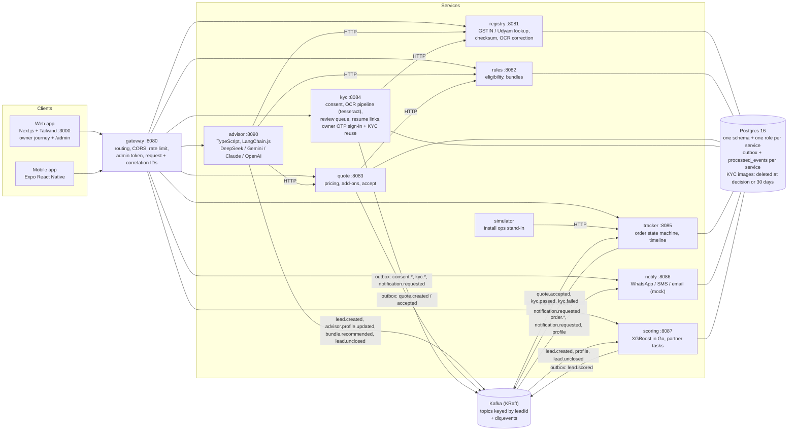
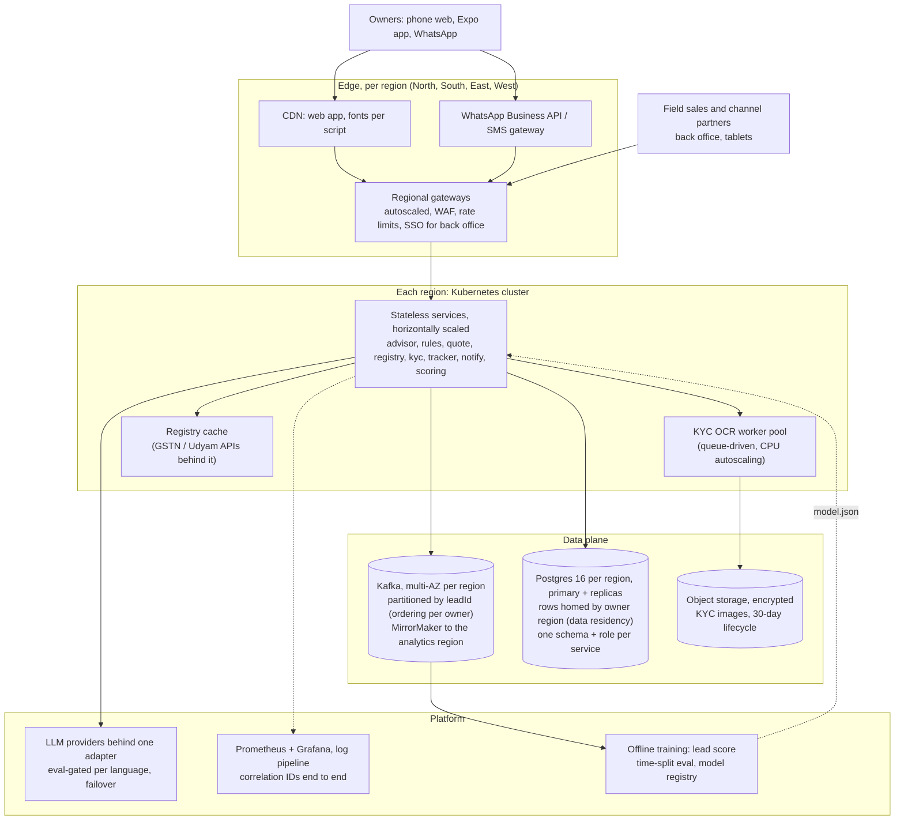

# Architecture

Two topologies: the **demo** we run (one docker compose) and the **national-scale** design it is built for. Rendered images: `docs/architecture-demo.png`, `docs/architecture-national.png` (regenerate with `node scripts/render-diagrams.mjs`).

## 1. Demo topology (docker compose)

Key properties:
- **Decisions are code:** eligibility, pricing and KYC verdicts are deterministic Go. The LLM only converses, extracts a profile, and phrases replies the guard has checked.
- **No lost events:** writes and their events commit together (transactional outbox). Consumers are idempotent (`processed_events`), retry with backoff, then dead-letter. Proven by `make integration` and `make drills`.
- **Owner accounts:** OTP sign-in, order history and KYC reuse live in the kyc service; a reused verification is re-checked against the registry and expires after 365 days.
- **Isolation:** each service owns its schema through its own Postgres role; services talk through Kafka or HTTP only.
- **Graceful degradation:** if rules or quote is down, the advisor keeps everything the owner said, apologises that pricing is briefly unavailable (no product or price is guessed), and quotes when they try again.
- **Observability:** `/metrics` on every service, JSON logs with request and correlation IDs, and an admin status page.

## 2. National-scale topology

What changes from the demo:
- **Data:** Postgres 16 in each region (primary plus read replicas); each owner's rows live in their home region. Same engine as the demo, so no migration.
- **Kafka:** partitioned by `leadId`, so one owner's events stay in order while partitions scale out.
- **Gateways:** per region, with WAF and back-office SSO.
- **KYC:** OCR moves to a worker pool, and images move to encrypted object storage with lifecycle deletion.
- **Notifications:** real WhatsApp and SMS adapters replace the mocks behind the same interface.
- **Model:** the scoring model is retrained offline and shipped as `model.json` through a registry.

The service code and contracts stay the same.
